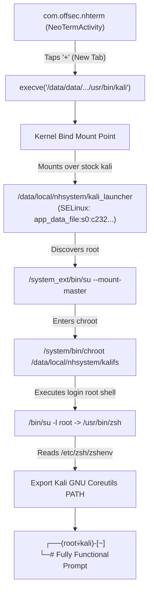

# nethunter-terminal-permanent-fix
Permanent Kali NetHunter terminal launcher repair using Magisk, SELinux context management, Linux bind mounts, chroot configuration, and boot persistence.


# Kali NetHunter Terminal Permanent Repair Guide: `-c: command not found` & Launcher Reversion Fix

## 1. Overview & Problem Statement

On rooted Android devices running Kali NetHunter via chroot and the NetHunter Terminal app (`com.offsec.nhterm`), launching a Kali shell either fails immediately or breaks across application restarts with the following errors:

1. **Launcher Failure**:
   ```text
   -c: command not found
   ```
2. **Chroot Execution Failure**:
   ```text
   chroot: exec su: No such file or directory
   ```
3. **SELinux Permission Denial**:
   ```text
   exec("/data/data/com.offsec.nhterm/files/usr/bin/kali"): Permission denied
   [Process completed (code 1) - press Enter]
   ```
4. **App Cold-Start Reversion**:
   Editing `/data/data/com.offsec.nhterm/files/usr/bin/kali` works only until the NetHunter Terminal app is closed. Upon cold start, the app overwrites changes and restores the broken Version 1.0.2 launcher.
5. **Binary Shadowing in Chroot**:
   Inside Kali, commands like `id`, `ls`, or `whoami` resolve to Android's Toybox `/system/bin` binaries instead of Kali's GNU Coreutils.

This document details the root cause analysis, architecture of the solution, step-by-step repair commands, script definitions, and actual outputs verified across device reboots.

---

## 2. Target Environment Specifications

- **Device Serial**: `HA1PBKQE`
- **Host OS**: Windows 11 (ADB Platform-Tools)
- **Target OS**: Android 12 / 13 (Linux Kernel 4.14.186 aarch64)
- **Root Management**: Magisk (Root binary located at `/system_ext/bin/su`)
- **Terminal Application**: `com.offsec.nhterm` (Fork of NeoTerm)
- **Kali Distribution**: Kali GNU/Linux Rolling 2025.3 (ARM64)
- **Chroot Filesystem**: `/data/local/nhsystem/kali-arm64` (Symlinked to `/data/local/nhsystem/kalifs`)
- **Terminal Launcher Path**: `/data/data/com.offsec.nhterm/files/usr/bin/kali`

---

## 3. Root Cause Analysis

### A. The `-c: command not found` Defect
In the stock launcher (Version 1.0.2 extracted from `nhterm.apk` assets):
```bash
SU1=$(which su)
SU2="$SU1 -c $@"
...
$SU2 /system/bin/chroot /data/local/nhsystem/kalifs su
```
- The hardcoded launcher `PATH` omits `/system_ext/bin`.
- Because modern Android ROMs place the Magisk `su` binary at `/system_ext/bin/su`, `which su` returns nothing (`SU1=""`).
- `$SU2` evaluates to `-c ...`, which Bash interprets as attempting to execute a binary named `-c`, throwing `-c: command not found`.

### B. Toybox Chroot Path Resolution
Toybox `/system/bin/chroot` takes a chroot path and an executable:
```bash
/system/bin/chroot /data/local/nhsystem/kalifs su
```
- Toybox `chroot` does not look up `su` in the target's `PATH`. It attempts to execute `/su` at the root of `kalifs`, failing with:
  ```text
  chroot: exec su: No such file or directory
  ```

### C. The APK Asset Overwrite Loop
Decompilation of `classes2.dex` from `nhterm.apk` revealed that `com.offsec.nhterm.component.userscript.UserScriptComponent` executes this on every application start:
```java
Shell.cmd("rm -rf /data/data/com.offsec.nhterm/files/usr/bin/*").exec();
extractAssetsDir("bin", "/data/data/com.offsec.nhterm/files/usr/bin");
```
Any standard file modification to `files/usr/bin/kali` is erased on the next cold start.

### D. SELinux MLS Multi-Category Denial
When a custom script is placed at `/data/local/nhsystem/kali_launcher`, its SELinux context is `u:object_r:system_data_file:s0`. The `com.offsec.nhterm` app runs in SELinux domain `untrusted_app_27:s0:c232,c256,c512,c768`. Android SELinux policy strictly denies untrusted apps from executing `system_data_file`:
```text
avc: denied { execute } for comm="m.offsec.nhterm" name="kali_launcher" dev="dm-6" ino=52555 scontext=u:r:untrusted_app_27:s0:c232,c256,c512,c768 tcontext=u:object_r:system_data_file:s0 tclass=file
```

### E. Zsh Environment Inheritance (Binary Shadowing)
Inside Kali, `/etc/passwd` configures `root` to use `/usr/bin/zsh`. Zsh reads `/etc/zsh/zshenv`, which had:
```zsh
if [[ -z "$PATH" || "$PATH" == "/bin:/usr/bin" ]]
then
    export PATH="/usr/local/bin:/usr/bin:/bin:/usr/games"
fi
```
Because the shell inherited Android's `PATH` (`/sbin:/system/bin:...`), `$PATH` was not empty, so Zsh left Android's `/system/bin` at the beginning of `PATH`.

---

## 4. Architecture of the Permanent Solution



1. **Kernel Bind-Mount Defense**:
   Linux kernel blocks `rm -rf` from unlinking an active mount point with `EBUSY` (`Device or resource busy`). Bind-mounting `/data/local/nhsystem/kali_launcher` over `/data/data/com.offsec.nhterm/files/usr/bin/kali` makes the script completely immune to the app's startup cleanup.
2. **Magisk Boot Persistence (`service.d`)**:
   A script in `/data/adb/service.d/99-kali-launcher.sh` executes automatically at boot (`sys.boot_completed=1`), dynamically detects the app's MLS SELinux context, and reapplies the bind mount.
3. **Zsh Environment Override**:
   Setting `export PATH="/usr/local/sbin:/usr/local/bin:/usr/sbin:/usr/bin:/sbin:/bin"` in `/etc/zsh/zshenv` ensures Kali GNU Coreutils always precede Android Toybox binaries.

---

## 5. Step-by-Step Implementation

### Step 1: Create the Verified Production Launcher
Path on device: `/data/local/nhsystem/kali_launcher`

```bash
#!/data/data/com.offsec.nhterm/files/usr/bin/bash
# Kali NetHunter Launcher - Permanent Edition

# 1. Reliable Root Binary Discovery
SU=""
for s in /system_ext/bin/su /system/bin/su /system/xbin/su /sbin/su /data/adb/magisk/su; do
    if [ -x "$s" ]; then
        SU="$s"
        break
    fi
done
[ -z "$SU" ] && SU=$(which su 2>/dev/null)
if [ -z "$SU" ]; then
    echo "[-] Error: su binary not found"
    exit 1
fi

# 2. Environment Sanitization
unset TMP
unset TMPDIR
unset HOME
unset LD_PRELOAD
unset LD_LIBRARY_PATH

export TERM=xterm-256color
export LANG=en_US.UTF-8
export USER=root
export LOGNAME=root
export HOME=/root
export PATH=/usr/local/sbin:/usr/local/bin:/usr/sbin:/usr/bin:/sbin:/bin

CHROOT_BIN=/system/bin/chroot
KALIFS=/data/local/nhsystem/kalifs

# 3. Execution Flow
if [ "$(id -u 2>/dev/null)" = "0" ]; then
    if [ $# -gt 0 ]; then
        exec "$CHROOT_BIN" "$KALIFS" /bin/su -l root -c "$*"
    else
        exec "$CHROOT_BIN" "$KALIFS" /bin/su -l root
    fi
else
    if [ $# -gt 0 ]; then
        exec "$SU" --mount-master -c "exec $CHROOT_BIN $KALIFS /bin/su -l root -c \"$*\""
    else
        exec "$SU" --mount-master -c "exec $CHROOT_BIN $KALIFS /bin/su -l root"
    fi
fi
```

### Step 2: Configure Permissions and SELinux Context
Run via ADB root shell:
```bash
chmod 755 /data/local/nhsystem/kali_launcher

# Dynamically inherit the app's MLS category from nhterm
APP_CTX=$(ls -Zd /data/data/com.offsec.nhterm/files/usr/bin/bash 2>/dev/null | awk '{print $1}')
chcon "$APP_CTX" /data/local/nhsystem/kali_launcher
```

### Step 3: Apply the Kernel Bind Mount
```bash
mkdir -p /data/data/com.offsec.nhterm/files/usr/bin
touch /data/data/com.offsec.nhterm/files/usr/bin/kali
chmod 755 /data/data/com.offsec.nhterm/files/usr/bin/kali
mount -o bind /data/local/nhsystem/kali_launcher /data/data/com.offsec.nhterm/files/usr/bin/kali
```

### Step 4: Fix Binary Resolution in Kali Zsh
Update `/data/local/nhsystem/kalifs/etc/zsh/zshenv`:
```bash
# /etc/zsh/zshenv: system-wide .zshenv file for zsh(1).
export PATH="/usr/local/sbin:/usr/local/bin:/usr/sbin:/usr/bin:/sbin:/bin"
```

Also verify the defensive fallback symlink:
```bash
ln -sf /bin/su /data/local/nhsystem/kalifs/su
```

### Step 5: Install Magisk Boot Persistence Service
Create `/data/adb/service.d/99-kali-launcher.sh`:

```bash
#!/system/bin/sh
# Kali NetHunter Terminal Launcher Boot Persistence Service
# Location: /data/adb/service.d/99-kali-launcher.sh

LOG="/data/local/nhsystem/boot_service.log"
exec > "$LOG" 2>&1
echo "=== [$(date)] Starting Kali NetHunter Boot Service ==="

# 1. Wait for Android boot completion
until [ "$(getprop sys.boot_completed)" = "1" ]; do
    sleep 1
done
echo "[+] Android boot completed detected"

# 2. Wait for decrypted storage / nhterm directory
for i in $(seq 1 45); do
    if [ -d /data/data/com.offsec.nhterm/files/usr/bin ]; then
        echo "[+] nhterm usr/bin directory is available"
        break
    fi
    sleep 1
done

# 3. Ensure target directory and placeholder file exist
mkdir -p /data/data/com.offsec.nhterm/files/usr/bin
touch /data/data/com.offsec.nhterm/files/usr/bin/kali
chmod 755 /data/data/com.offsec.nhterm/files/usr/bin/kali

# 4. Dynamically detect and inherit SELinux context from nhterm
APP_CTX=$(ls -Zd /data/data/com.offsec.nhterm/files/usr/bin/bash 2>/dev/null | awk '{print $1}')
[ -z "$APP_CTX" ] && APP_CTX=$(ls -Zd /data/data/com.offsec.nhterm/files/usr/bin 2>/dev/null | awk '{print $1}')
[ -z "$APP_CTX" ] && APP_CTX="u:object_r:app_data_file:s0:c232,c256,c512,c768"

echo "[+] Applying SELinux context: $APP_CTX"
chmod 755 /data/local/nhsystem/kali_launcher
chcon "$APP_CTX" /data/local/nhsystem/kali_launcher 2>/dev/null

# 5. Bind mount permanent launcher
if ! mount | grep -q "/data/data/com.offsec.nhterm/files/usr/bin/kali"; then
    echo "[*] Applying bind mount over /data/data/com.offsec.nhterm/files/usr/bin/kali"
    mount -o bind /data/local/nhsystem/kali_launcher /data/data/com.offsec.nhterm/files/usr/bin/kali
else
    echo "[*] Bind mount already present"
fi

# 6. Ensure fallback symlink /su in kalifs
if [ ! -e /data/local/nhsystem/kalifs/su ]; then
    echo "[*] Creating fallback /su -> /bin/su in kalifs"
    ln -sf /bin/su /data/local/nhsystem/kalifs/su
fi

echo "=== [$(date)] Kali NetHunter Boot Service Completed ==="
```

Set permissions:
```bash
chmod 755 /data/adb/service.d/99-kali-launcher.sh
```

### Step 6: Install Dedicated Recovery Utility
Create `/data/local/nhsystem/recovery.sh`:

```bash
#!/system/bin/sh
# Kali NetHunter Diagnostic & Recovery Utility
# Location: /data/local/nhsystem/recovery.sh

BACKUP_DIR="/data/local/nhsystem/repair-backups"
LAUNCHER_SRC="/data/local/nhsystem/kali_launcher"
NHTERM_LAUNCHER="/data/data/com.offsec.nhterm/files/usr/bin/kali"
KALIFS="/data/local/nhsystem/kalifs"
SERVICE_SCRIPT="/data/adb/service.d/99-kali-launcher.sh"

echo "=========================================================="
echo "      KALI NETHUNTER DIAGNOSTIC & RECOVERY TOOL"
echo "=========================================================="

if [ "$(id -u)" != "0" ]; then
    echo "[-] Error: recovery.sh must be run as root (su)"
    exit 1
fi

echo "[*] Step 1: Checking Android Root Binary..."
SU_BIN=""
for s in /system_ext/bin/su /system/bin/su /system/xbin/su /sbin/su /data/adb/magisk/su; do
    if [ -x "$s" ]; then
        SU_BIN="$s"
        break
    fi
done
[ -n "$SU_BIN" ] && echo "    [+] Root binary found: $SU_BIN" || echo "    [-] ERROR: No functional su found!"

echo "[*] Step 2: Checking Kali Root Filesystem..."
if [ -d "$KALIFS" ] && [ -x "$KALIFS/bin/bash" ]; then
    echo "    [+] Kali rootfs verified at $KALIFS"
    echo "    [+] Distribution: $(cat $KALIFS/etc/os-release 2>/dev/null | grep PRETTY_NAME | cut -d= -f2 | tr -d '\"')"
else
    echo "    [-] ERROR: Kali rootfs invalid or missing at $KALIFS"
fi

echo "[*] Step 3: Checking Fallback /su Symlink in Kali..."
if [ -L "$KALIFS/su" ]; then
    echo "    [+] $KALIFS/su symlink exists -> $(ls -l $KALIFS/su | awk '{print $NF}')"
else
    echo "    [!] Creating fallback /su -> /bin/su..."
    ln -sf /bin/su "$KALIFS/su"
fi

echo "[*] Step 4: Checking Kali Launcher..."
if [ -f "$LAUNCHER_SRC" ]; then
    echo "    [+] Source launcher exists: $LAUNCHER_SRC"
    APP_CTX=$(ls -Zd /data/data/com.offsec.nhterm/files/usr/bin/bash 2>/dev/null | awk '{print $1}')
    [ -n "$APP_CTX" ] && chcon "$APP_CTX" "$LAUNCHER_SRC" 2>/dev/null
    chmod 755 "$LAUNCHER_SRC"
    echo "    [+] Launcher permissions and context verified"
else
    echo "    [!] Restoring $LAUNCHER_SRC from backup..."
    cp "$BACKUP_DIR/kali_launcher.verified" "$LAUNCHER_SRC"
    chmod 755 "$LAUNCHER_SRC"
fi

echo "[*] Step 5: Checking Active Bind Mount..."
if mount | grep -q "$NHTERM_LAUNCHER"; then
    echo "    [+] Active bind mount confirmed on $NHTERM_LAUNCHER"
else
    echo "    [!] Applying bind mount..."
    mkdir -p /data/data/com.offsec.nhterm/files/usr/bin
    touch "$NHTERM_LAUNCHER"
    chmod 755 "$NHTERM_LAUNCHER"
    mount -o bind "$LAUNCHER_SRC" "$NHTERM_LAUNCHER"
    mount | grep -q "$NHTERM_LAUNCHER" && echo "    [+] Bind mount applied successfully!" || echo "    [-] Failed to apply mount!"
fi

echo "[*] Step 6: Checking Boot Persistence Service..."
if [ -f "$SERVICE_SCRIPT" ] && [ -x "$SERVICE_SCRIPT" ]; then
    echo "    [+] Boot persistence script verified: $SERVICE_SCRIPT"
else
    echo "    [!] Restoring $SERVICE_SCRIPT from backup..."
    cp "$BACKUP_DIR/99-kali-launcher.sh.verified" "$SERVICE_SCRIPT"
    chmod 755 "$SERVICE_SCRIPT"
fi

echo "[*] Step 7: Performing Smoke Test in Kali Chroot..."
TEST_OUT=$(/system/bin/chroot "$KALIFS" /bin/su -l root -c "id; uname -m; echo CHROOT_OK" 2>&1)
if echo "$TEST_OUT" | grep -q "CHROOT_OK"; then
    echo "    [+] Kali chroot smoke test passed successfully!"
    echo "    [+] Output: $TEST_OUT"
else
    echo "    [-] ERROR: Kali smoke test failed!"
    echo "    [-] Output: $TEST_OUT"
fi

echo "=========================================================="
echo "    DIAGNOSTIC & RECOVERY CHECK COMPLETE"
echo "=========================================================="
```

Set permissions:
```bash
chmod 755 /data/local/nhsystem/recovery.sh
```

---

## 6. Verification Commands & Expected Outputs

### A. Run Diagnostic Tool
Command:
```bash
adb shell su -c "/system/bin/sh /data/local/nhsystem/recovery.sh"
```

Expected Output:
```text
==========================================================
      KALI NETHUNTER DIAGNOSTIC & RECOVERY TOOL
==========================================================
[*] Step 1: Checking Android Root Binary...
    [+] Root binary found: /system_ext/bin/su
[*] Step 2: Checking Kali Root Filesystem...
    [+] Kali rootfs verified at /data/local/nhsystem/kalifs
    [+] Distribution: Kali GNU/Linux Rolling
[*] Step 3: Checking Fallback /su Symlink in Kali...
    [+] /data/local/nhsystem/kalifs/su symlink exists -> /bin/su
[*] Step 4: Checking Kali Launcher...
    [+] Source launcher exists: /data/local/nhsystem/kali_launcher
    [+] Launcher permissions and context verified
[*] Step 5: Checking Active Bind Mount...
    [+] Active bind mount confirmed on /data/data/com.offsec.nhterm/files/usr/bin/kali
[*] Step 6: Checking Boot Persistence Service...
    [+] Boot persistence script verified: /data/adb/service.d/99-kali-launcher.sh
[*] Step 7: Performing Smoke Test in Kali Chroot...
    [+] Kali chroot smoke test passed successfully!
    [+] Output: uid=0(root) gid=0(root) groups=0(root)
aarch64
CHROOT_OK
==========================================================
    DIAGNOSTIC & RECOVERY CHECK COMPLETE
==========================================================
```

### B. Verify Boot Persistence Log (Post-Reboot)
Command:
```bash
adb shell su -c "cat /data/local/nhsystem/boot_service.log"
```

Expected Output:
```text
=== [Tue Nov 10 11:02:46 IST 2026] Starting Kali NetHunter Boot Service ===
[+] Android boot completed detected
[+] nhterm usr/bin directory is available
[+] Applying SELinux context: u:object_r:app_data_file:s0:c232,c256,c512,c768
[*] Applying bind mount over /data/data/com.offsec.nhterm/files/usr/bin/kali
[*] Creating fallback /su -> /bin/su in kalifs
=== [Tue Nov 10 11:03:44 IST 2026] Kali NetHunter Boot Service Completed ===
```

### C. Verify Active Bind Mount
Command:
```bash
adb shell su -c "mount | grep kali"
```

Expected Output:
```text
/dev/block/dm-7 on /data/data/com.offsec.nhterm/files/usr/bin/kali type ext4 (rw,seclabel,nosuid,nodev,noatime,nobarrier,noauto_da_alloc,inlinecrypt,resuid=10010,resgid=1065,errors=panic,data=ordered)
/dev/block/dm-7 on /data_mirror/data_ce/null/0/com.offsec.nhterm/files/usr/bin/kali type ext4 (rw,seclabel,nosuid,nodev,noatime,nobarrier,noauto_da_alloc,inlinecrypt,resuid=10010,resgid=1065,errors=panic,data=ordered)
/dev/block/dm-7 on /data/user/0/com.offsec.nhterm/files/usr/bin/kali type ext4 (rw,seclabel,nosuid,nodev,noatime,nobarrier,noauto_da_alloc,inlinecrypt,resuid=10010,resgid=1065,errors=panic,data=ordered)
```

### D. Full Command Resolution & Coreutils Verification
Execute the following inside Kali chroot:
```bash
adb shell su -c '/system/bin/chroot /data/local/nhsystem/kalifs /usr/bin/zsh -l -c "
echo \"=== IDENTITY ===\"
whoami
id
pwd
echo \"=== PATH ===\"
echo \$PATH
echo \"=== COMMAND RESOLUTION ===\"
which whoami id ls apt ip ping curl
echo \"=== TOOL VERSIONS ===\"
apt --version
ip addr show wlan0 | head -n 4
echo \"=== NETWORK CONNECTIVITY ===\"
ping -c 3 1.1.1.1
curl -4 -I --connect-timeout 5 https://www.google.com | head -n 5
"'
```

Expected Output:
```text
=== IDENTITY ===
root
uid=0(root) gid=0(root) groups=0(root)
/
=== PATH ===
/usr/local/sbin:/usr/local/bin:/usr/sbin:/usr/bin:/sbin:/bin
=== COMMAND RESOLUTION ===
/usr/bin/whoami
/usr/bin/id
/usr/bin/ls
/usr/bin/apt
/usr/sbin/ip
/usr/bin/ping
/usr/bin/curl
=== TOOL VERSIONS ===
apt 3.1.4 (arm64)
32: wlan0: <BROADCAST,MULTICAST,UP,LOWER_UP> mtu 1500 qdisc mq state UP group default qlen 3000
    link/ether ce:50:ce:7a:4d:0c brd ff:ff:ff:ff:ff:ff
    inet 10.123.0.242/18 brd 10.123.63.255 scope global dynamic wlan0
       valid_lft 3108sec preferred_lft 3108sec
=== NETWORK CONNECTIVITY ===
PING 1.1.1.1 (1.1.1.1) 56(84) bytes of data.
64 bytes from 1.1.1.1: icmp_seq=1 ttl=53 time=19.2 ms
64 bytes from 1.1.1.1: icmp_seq=2 ttl=53 time=19.6 ms
64 bytes from 1.1.1.1: icmp_seq=3 ttl=53 time=20.0 ms

--- 1.1.1.1 ping statistics ---
3 packets transmitted, 3 received, 0% packet loss, time 2003ms
rtt min/avg/max/mdev = 19.226/19.615/20.028/0.327 ms
HTTP/2 200 
content-type: text/html; charset=ISO-8859-1
```

### E. Interactive NetHunter Terminal UI Verification
Opening `com.offsec.nhterm` and pressing `+` directly presents the interactive Kali prompt:

```text
root@kali: ~
┌──(root💀kali)-[~]
└─# id
uid=0(root) gid=0(root) groups=0(root),3004(inet)

┌──(root💀kali)-[~]
└─# uname -a
Linux kali 4.14.186-gf49e3fb57266 #1 SMP PREEMPT Wed Oct 16 16:27:17 CST 2024 aarch64 GNU/Linux
```
No `-c: command not found`, no `Permission denied`, and no reversion on reboot.


